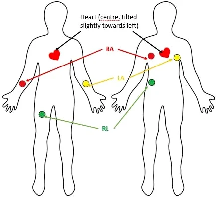

# ECG-elektrodes plaatsen (AD8232)

*Bron afbeelding: [Circuit Digest, "Understanding ECG Sensor and Program AD8232 ECG Sensor with Arduino"](https://circuitdigest.com/microcontroller-projects/understanding-ecg-sensor-and-program-ad8232-ecg-sensor-with-arduino-to-diagnose-various-medical-conditions).*

Het polsstation gebruikt de **borstplaatsing** (rechts in de afbeelding). Zo meet hij continu, zonder dat de astronaut iets hoeft te doen. Zie `ontwerpkeuzes.md`, punt 3.

| Kleur (kit-kabel) | Naam | Plek op de borst | AD8232-pad |
|---|---|---|---|
| 🔴 Rood | RA (right arm) | Rechts, net onder het sleutelbeen | RA |
| 🟡 Geel | LA (left arm) | Links, net onder het sleutelbeen, richting de schouder | LA |
| 🟢 Groen | RL (right leg, referentie) | Onderste ribben, onder LA (zoals in de afbeelding) | RL |

- **RL is de referentie-elektrode.** De precieze plek is niet kritisch, zolang hij een eind van RA en LA af zit. In de afbeelding zit hij links onder. Rechts onder werkt ook.
- **Meet de kleuren na** als de kabel is doorgeknipt en op de pads RA/LA/RL is gesoldeerd. Niet elke kabel volgt dezelfde kleurcode.

## Tips voor een schoon signaal

- Maak de huid schoon en droog, met een beetje alcohol als je dat hebt.
- Klik de elektrode eerst op het drukknopje en plak hem daarna.
- Vermijd haar en botten direct onder de elektrode.
- Zit stil bij de eerste test in de Serial Plotter.
- LO+ of LO− hoog = een elektrode zit los.
